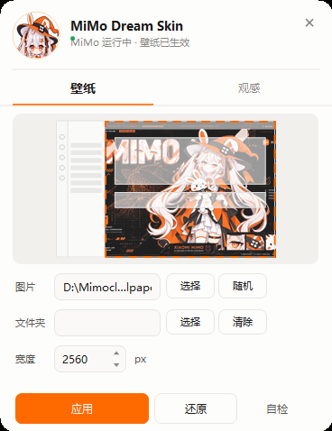

# MimoPet

[Xiaomi MiMo Desktop](https://mimo.xiaomi.com) 的桌宠工具箱：壁纸、Token 用量、余额查询、思考强度。单个 exe，双击即用。



打开后是一只常驻桌面的 MiMo 小角色（138×154），不占任务栏、不进 Alt+Tab。悬停弹出思考气泡菜单，单击打开工具箱。

> **MiMo 形象来源**：桌宠及界面头像使用的 MiMo 角色形象来自 B 站用户 [id1758596086](https://space.bilibili.com/1758596086) 发布的版本，版权归原作者所有。本工具与其官方无关，仅供个人使用。

## 功能

### 🖼️ 壁纸

- 选单张图片，或指定文件夹每次随机挑一张
- 渲染区域：主工作区 / 整个窗口 / 仅侧边栏 / 仅内容区 / 自定义 CSS 选择器
- 取景：裁切铺满 / 完整显示 / 拉伸 / 自定义缩放 + 位置微调
- 观感：遮罩强度、面板透明度（浅色/深色分开）、背景模糊
- 一键应用并重启，随时逐字节还原

### 📊 Token 用量

多网关自由切换，按日期、按模型统计：

| 网关类型 | 数据 | 填什么 |
|---|---|---|
| 本地 OFM 网关 | token / TTFT / 生成速度 | stats.json 路径（默认自动） |
| one-api / new-api 中转站 | 输出 token / 调用数 | URL + API Key + 用户 ID |
| OpenRouter 官方 | token（含思考）/ 花费 | Management Key |

### 💰 余额查询

全自定义数据源：任意 URL + Key + 取值路径（支持 `data.balance`、`info.items[0].total` 语法），自动探测常见字段名（balance / quota / credits…），多账号、定时刷新、低额红字提醒。

### 🧠 思考强度

一键给 MiMo Desktop 打思考强度补丁：打完后**在 MiMo 自己的模型选择器里**，每个模型会原生显示按真实声明（来自本地网关）的思考挡位菜单，直接点选，档位名原样下发。

- 幂等重放（MiMo 更新后重跑一次）
- 一键卸载（还原官方原始文件）
- 当前模型挡位查看 + 任意模型挡位预查询

## 桌宠操作

| 操作 | 效果 |
| --- | --- |
| 悬停 400ms | 弹出思考气泡菜单 |
| 拖动 | 换位置，位置会记住 |
| 双击 | 打开工具箱 |
| 右键 | 打开工具箱 / 回到右下角 / 退出 |

## 工作原理

壁纸：把皮肤 CSS 追加到 MiMo 渲染层主 CSS 文件尾部（新版 runtime-res 架构），壁纸图片作为独立文件放入 assets 目录 —— 不修改 index.html，不触发资源完整性校验。

思考强度：向 runtime-res 里的渲染层与引擎注入档位查表逻辑，档位表从本地网关的模型声明抓取。补丁器作为嵌入资源随 exe 分发，运行时释放并用 Node 执行。

## 使用

1. 从 [Releases](../../releases) 下载 `MimoPet.exe`
2. 双击运行，桌宠出现在屏幕右下角（**不要**从 MiMo 内部的终端启动——写壁纸需先关闭 MiMo，会连带关掉调用它的会话；程序检测到这种情况会弹窗提醒）
3. 悬停桌宠 → 点气泡里的功能按钮进入对应工具

## 命令行

```
MimoPet.exe                       显示桌宠
MimoPet.exe panel                 直接打开工具箱
MimoPet.exe verify                校验壁纸注入状态
MimoPet.exe restore               还原原始外观
MimoPet.exe apply --wall <图片>    直接应用壁纸
```

## 从源码构建

需要 Windows 和 .NET Framework 4.x（Windows 10/11 自带）。

```powershell
powershell -ExecutionPolicy Bypass -File build.ps1
```

产物在 `dist\MimoPet.exe`（约 500 KB，含桌宠贴图、思考补丁器与档位表）。不需要安装 SDK。

## 安全性

- 壁纸注入前自动备份，失败自动回滚，哈希校验覆盖全部归档文件
- 不使用强制结束进程，避免损坏 Electron 单实例锁
- 思考补丁保留 pristine 原始文件备份，可一键还原
- API Key 以明文存储在本机配置文件（`mimoskin-*.json`），不上传；请勿把配置文件同步到公开位置

## 已知限制

- 仅支持 Windows
- 绑定 MiMo Desktop 当前界面结构，客户端更新后可能需要重新适配（壁纸重按一次即可；思考补丁点「重放补丁」）
- 只有 2 档以上强度的模型才显示挡位菜单（开关型思考模型无强度概念）
- 部分模型是网关侧真不支持思考档位，补丁不会让它们出现菜单

## 许可

[MIT](LICENSE)

本项目与小米公司无关，是社区工具。MiMo 角色形象版权归其作者所有。
